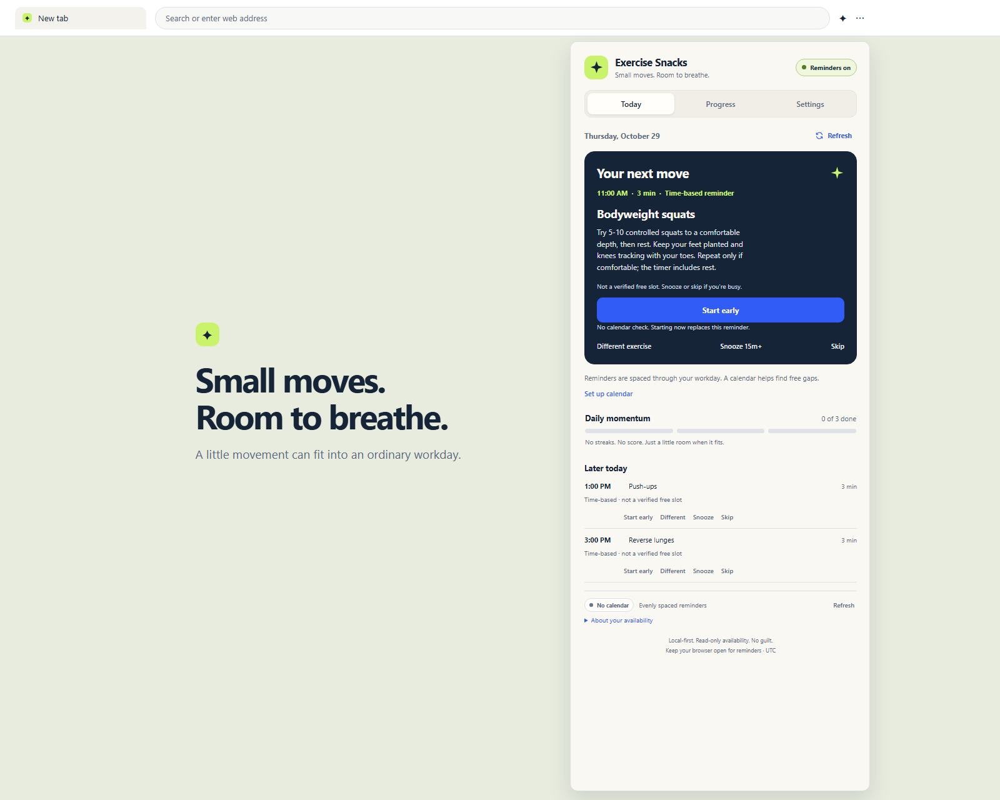
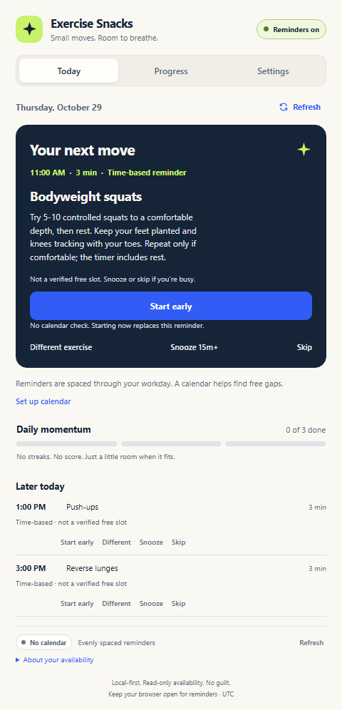
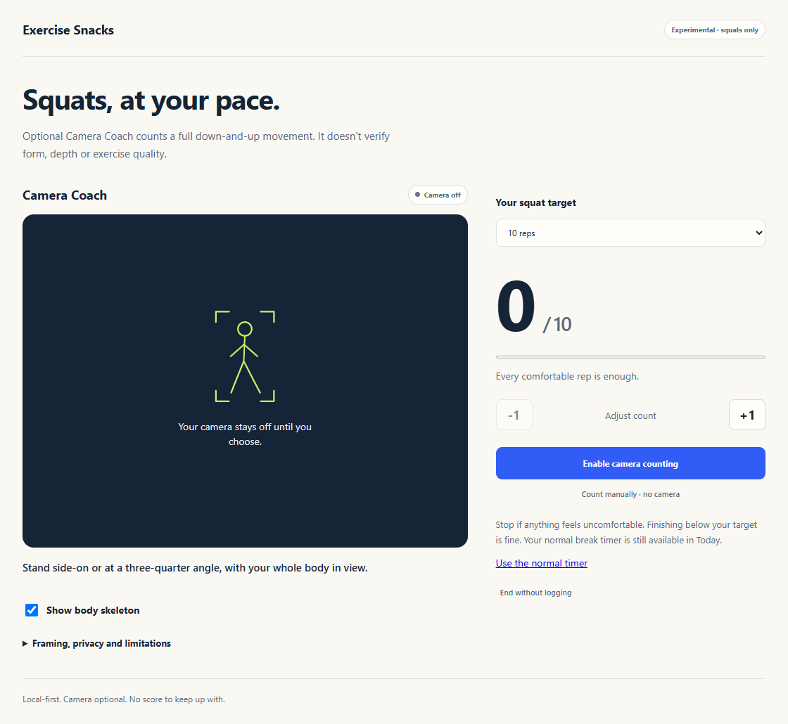
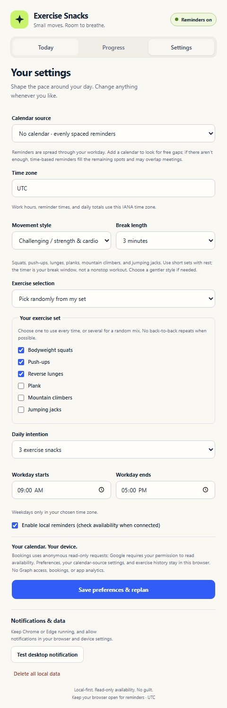

# Exercise Snacks

**Small moves. Room to breathe.**

Make a little room for movement between the things already on your calendar.
Exercise Snacks is a lightweight Chrome and Edge extension that nudges you to
take a 2- to 5-minute exercise break, helps you get started, and keeps track of
what you finish. No Exercise Snacks account or cloud backend.

**[Download the published install ZIP (v0.2.0)](https://github.com/jfilcik/exercise-snacks/releases/download/v0.2.0/exercise-snacks.zip)** · [Install steps](#install-in-chrome-or-edge) · [Technical README](docs/technical.md)

> The direct download is the latest ZIP currently published on GitHub (v0.2.0). The current development build is v0.3.5 and is attached in this conversation; it has not been published as a GitHub release yet.

## What could five minutes make possible?

You don't need a perfect opening to start a small habit.

In a [2025 study at Edith Cowan University](https://pmc.ncbi.nlm.nih.gov/articles/PMC12354585/),
22 previously sedentary adults, ages 32–69, completed a four-week home exercise
program designed to take just five minutes a day. The researchers reported:

| A small daily routine | Average improvement after four weeks |
| --- | --- |
| Lower-body strength, measured by an isometric mid-thigh pull | **+13%** |
| Push-up test repetitions | **+66%** |

The routine started with **10 chair squats, 10 wall push-ups, 10 chair reclines,
and 10 heel drops**. Each repetition emphasized a slow, five-second lowering
phase and a one-second raising phase, with harder variations introduced as
movements became easier. Exercises could be done together or spread through
the day. Participants completed an average of **91% of sessions**.

**Encouraging evidence, not a promise.** This was a small, short study using a
two-week within-person control period, not a randomized parallel-group trial.
Results varied substantially between participants. DEXA scans found no
significant change in lean mass; the study does not establish long-term muscle
preservation or replace broader physical-activity recommendations.

Exercise Snacks was not tested in the study and does not reproduce its full
routine or prescribed tempo. The inspiration is simpler: **make a little
movement easier to remember and easier to begin.**

## From "I'll do it later" to a little movement now

**A reminder, not another obligation.** Choose two or three snacks per weekday
and your work hours. Without a calendar, reminders are spread through the
remaining day. Add Microsoft personal Bookings to look for free gaps; if there
aren't enough, clearly labeled time-based reminders fill the remaining spots.
Those aren't verified free slots and may overlap meetings. Snooze or skip
without guilt.

**Something you actually want to do.** Choose gentle, seated-friendly movement,
an easy walk, or an opt-in strength/cardio mix with squats, push-ups, lunges,
planks, and more. Pick a favorite or let the app choose from your set.
Start early whenever you're ready, without waiting for a calendar check.

**Even a rep counter, if you want one.** Camera Coach opens in its own tab and
can estimate squat reps with your webcam. It is experimental, squats-only,
and does not verify form. The camera stays off until you enable it; images
and pose data aren't saved or uploaded. Manual counting, corrections, and
the ordinary timer are always available. Push-ups use the timer, not automatic
rep counting.

**Progress without pressure.** See completed snacks, minutes, and counted sets.
No streaks, leaderboard, or account to maintain. Preferences and exercise
history stay in your browser.

## Install in Chrome or Edge

**No Node.js or build tools needed for a ready-to-install ZIP.** Use Chrome or
Edge 120 or later on a computer that allows unpacked extensions.

> **Version note:** the current published ZIP is v0.2.0 and does not include
> Camera Coach or calendar-free reminders. The screenshots describe local
> v0.3.5. Use the attached v0.3.5 ZIP from this conversation or
> [build the current source](docs/technical.md#build-from-source-instead) to try these
> newer features until a v0.3.5 release is published.

1. For the latest published build, click the direct
   **[Exercise Snacks install ZIP download](https://github.com/jfilcik/exercise-snacks/releases/download/v0.2.0/exercise-snacks.zip)**.
   For v0.3.5 features, use the ZIP attached in this conversation or build the
   current source. Do not choose GitHub's **Source code (zip)**; that ZIP needs
   building first.
2. Extract it into a permanent folder, such as `C:\Apps\ExerciseSnacks`.
3. Open `chrome://extensions` or `edge://extensions`, turn on **Developer mode**,
   choose **Load unpacked**, and select the extracted folder containing
   `manifest.json`. Pin Exercise Snacks to the toolbar.
4. Open the extension, choose your movement style, work hours, and time zone,
   then **Save & plan my day**. Leave **No calendar** selected to start simply;
   you can connect one later.
5. In **Settings**, choose **Test desktop notification**. Allow notifications
   in your browser and operating system. Focus / Do Not Disturb can hide them.

Keep the browser running for reminders; the popup can stay closed.
To update, replace the files in the **same folder**, click **Reload** on the
extensions page, then reopen the popup. Don't remove the extension if you want
to keep its local settings and history.

### Want calendar-aware timing?

Use your own public **Microsoft personal Bookings / Bookings with me**
meeting-type link. Eligible Microsoft 365 Enterprise users may already have it;
your organization must allow the feature and public publishing.
[Follow the Bookings setup guide](docs/technical.md#microsoft-365-enterprise-set-up-personal-bookings).
Bookings is published availability, not access to your complete work calendar.

Google Calendar / Gmail is also supported through an
[optional OAuth-configured build](docs/technical.md#google-calendar-setup-optional-chrome).
The standard ZIP does not have Google sign-in configured. No Gmail messages
or event details are read; live Google sign-in has not been verified here.

Choose comfortable movement and stop if something feels uncomfortable. The
app offers reminders and estimates, not medical advice or a personalized
training prescription.

---

Building, permissions, privacy details, scheduling behavior, calendar setup,
camera limitations, and regression tests live in the [technical README](docs/technical.md).
